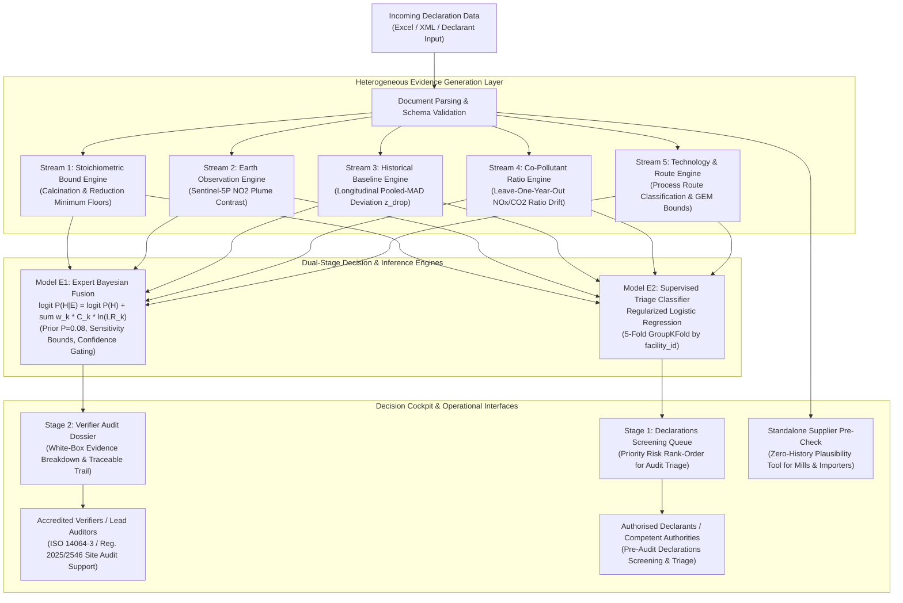

# Capstone Project Proposal: VeriCBAM
## Multimodal Evidence Fusion & Decision Support for CBAM Emissions Consistency Assessment

**Student Name:** Cristhian David Cáceres Mateus  
**Student ID / Matriculation No:** 93515346  
**Degree Program:** Master of Science in Data Science (M.Sc. DSc)  
**Academic Institution:** University of Europe for Applied Sciences (UE Germany), Potsdam Campus  
**Faculty Supervisor:** Dr. Humera Noor  
**Submission Date:** October 2026 (Semester Winter 2026/2027)  

---

## 1. Project Overview & Problem Statement

### 1.1 The Regulatory & Economic Context
Under **Regulation (EU) 2023/956**, the European Union's Carbon Border Adjustment Mechanism (CBAM) entered its definitive financial implementation phase on **1 January 2026**, following a transitional reporting period (October 2023 – December 2025) governed by **Commission Implementing Regulation (EU) 2023/1773**. European industrial importers—designated as *Authorised CBAM Declarants*—importing carbon-intensive commodities (**Cement, Iron & Steel, Aluminium, Fertilisers, Electricity, and Hydrogen**) face strict regulatory compliance obligations. 

Declarants are required to calculate, report, and surrender CBAM certificates corresponding to declared embedded emissions:
* **Scope Coverage:** Embedded direct greenhouse gas emissions (Scope 1) are mandatory across all covered sectors. Embedded indirect emissions (Scope 2 from consumed electricity) currently apply only to specific sectors designated under Annex II of Regulation (EU) 2023/956 (notably **Cement** and **Fertilisers**), while for **Iron & Steel** and **Aluminium**, only direct emissions are currently subject to certificate surrender during the initial rollout.
* **Certificate Pricing & Surrender Timeline:** Pursuant to **Commission Implementing Regulation (EU) 2025/2548**, CBAM certificate prices reflect the EU Emissions Trading System (EU ETS, Directive 2003/87/EC) allowance prices. During 2026, certificate prices are calculated on a quarterly basis, transitioning to weekly averages from 2027. Certificates become purchasable through the central CBAM registry from February 2027, with the first annual surrender deadline for 2026 imported emissions set for **30 September 2027**. Financial liability is phased in gradually, starting at approximately 2.5% in 2026 in direct alignment with the gradual phase-out of free EU ETS allowances under Directive 2003/87/EC Article 10a.
* **De Minimis Threshold:** The **Omnibus I Simplification Regulation (EU) 2025/2083** introduced a cumulative 50-tonne annual mass *de minimis* exemption threshold for small consignments, while the overwhelming majority of industrial import volume remains subject to mandatory compliance and verification.

### 1.2 The Industrial Screening Dilemma & Verification Bottleneck
European industrial buyers, customs declarants, and National Competent Authorities (such as Germany's *DEHSt*, France's *DGEC*, and the Netherlands' *NEa*) face significant operational and economic verification challenges:

1. **The Logistical Burden of Physical On-Site Audits:**  
   Under Regulation (EU) 2023/956 (Articles 8 and 18), **Commission Implementing Regulation (EU) 2025/2546** (verification principles), and **Commission Delegated Regulation (EU) 2025/2551** (verifier accreditation), independent third-party verification is required when claiming actual embedded emissions. While physical on-site installation visits represent the regulatory baseline under Article 10 of Implementing Regulation (EU) 2025/2546, performing comprehensive physical walk-throughs and fuel assay audits across complex overseas industrial installations (e.g., in India, China, Turkey, or Brazil) involves substantial logistical friction, international travel constraints, and high administrative expenditure. While provisions for virtual verification or waivers exist under tightly restricted conditions (e.g., low-complexity downstream units, force majeure), verifying integrated blast furnaces and multi-kiln cement facilities remains resource-constrained.

2. **The "Arithmetic of Scarcity" & Default Value Mark-Ups:**  
   The capacity of accredited verification bodies under the Accreditation and Verification Regulation (**AVR - Commission Implementing Regulation (EU) 2018/2067**) and dedicated CBAM rules is constrained relative to the thousands of overseas industrial supplying facilities. If an overseas installation fails to obtain timely verified emissions data, importers must surrender certificates calculated via the European Commission's **default emissions values** under **Commission Implementing Regulation (EU) 2025/2621**. These default values carry progressive administrative mark-ups that impose severe economic surcharges on importers compared to verified actual emissions.

3. **Critical Inconsistency & Technical Evasion Vectors:**  
   * **Vector A — Quantitative Understatement:** Under-reporting fuel combustion or raw material throughput to depress declared emissions below actual operational levels.
   * **Vector B — Stoichiometric Floor & Boundary Manipulation:** Declaring specific embedded emissions below the thermodynamic and chemical mass-balance minimums required for iron reduction or limestone calcination, or failing to account for high-calorific process gases transferred across plant boundaries.
   * **Vector C — Process Route Misclassification:** Misreporting high-carbon primary production routes (e.g., integrated Blast Furnace–Basic Oxygen Furnace, BF-BOF) as low-carbon secondary routes (e.g., Scrap-Electric Arc Furnace, Scrap-EAF).

### 1.3 The VeriCBAM Objective & Decision-Support Scope
**VeriCBAM** is an **explainable, multimodal industrial intelligence and decision-support system** designed to pre-screen and assess the consistency of self-reported CBAM declarations. 

Rather than replacing accredited legal verification bodies or directly metering stack $\text{CO}_2$ emissions from orbit, VeriCBAM operates as an **evidence-fusion screening copilot** for **Authorised CBAM Declarants** and **Accredited Verification Bodies**:
* It evaluates **physical plausibility** via first-principles chemical engineering mass balances and EU Best Available Techniques (BAT) reference benchmarks.
* It evaluates **operational activity consistency** via Copernicus Sentinel-5P TROPOMI tropospheric $\text{NO}_2$ atmospheric plume contrast.
* It checks longitudinal reporting consistency against **facility historical profiles and co-pollutant combustion ratios** ($\text{NO}_x/\text{CO}_2$) from public environmental compliance registries.
* It fuses these heterogeneous data streams through a **weighted Bayesian evidence-fusion engine (Model E1)** and a **supervised triage model (Model E2)** that provide transparent risk scoring alongside explicit confidence factors and abstention gates.
* It outputs an **explainable audit dossier** for human decision-makers, coupled with a **standalone pre-screening tool** for importers and overseas suppliers.

> **Methodological Scope & Regulatory Proxy Qualification:**  
> Because official third-country CBAM declarations are legally confidential business information during the transitional phase, the project's empirical benchmark utilizes authentic European facility-level emissions from the European Environment Agency (EEA E-PRTR / IED v16 database) as an **empirical reference proxy cohort** rather than confidential third-country declarations. Furthermore, E-PRTR data reflects operator-reported compliance data under Directive 2010/75/EU rather than third-party verified product intensities. VeriCBAM is positioned strictly as an advisory screening tool, maintaining human verifier authority under EU administrative law.

### 1.4 Related Work & Prior Literature
1. **Satellite Remote Sensing of Industrial Point Sources:** Spaceborne observation of industrial air pollution has advanced significantly with the TROPOspheric Monitoring Instrument (TROPOMI) aboard Copernicus Sentinel-5P (Veefkind et al., 2012). Recent studies demonstrate quantitative detection of nitrogen dioxide ($\text{NO}_2$) plumes over concentrated industrial clusters, power stations, and megacities (Beirle et al., 2019, 2021; Goldberg et al., 2019; Lorente et al., 2019). However, physical literature emphasizes that trace-gas plume dispersion is subject to atmospheric lifetimes, wind advection, and cloud obscuration, rendering satellite $\text{NO}_2$ an activity indicator rather than an isolated annual $\text{CO}_2$ meter.
2. **Statistical Anomaly Detection in Emissions Reporting:** Discrepancy screening in self-reported environmental compliance has been explored in emissions trading markets and regulatory registries (e.g., European Environment Agency data quality assurance protocols; US EPA Title V compliance checks). Prior statistical work has applied robust longitudinal deviation metrics and co-pollutant stoichiometry to flag reporting inconsistencies (IPCC, 2019).
3. **Physics-Informed Decision Support:** Integrating deterministic physical conservation laws with statistical anomaly detection has been demonstrated across chemical process engineering and maritime emissions monitoring, providing a sound theoretical foundation for multimodal evidence fusion in trade-related carbon accounting.

---

## 2. Project Objectives & Technical Hypotheses

### 2.1 Core Problem Statement & Overarching Objective
> **Can heterogeneous physical, observational, historical, and multi-pollutant evidence be systematically fused into an explainable decision-support model that identifies declared CBAM emissions inconsistencies more reliably than isolated single-modality sources?**

### 2.2 Technical Inquiries & Working Hypotheses
* **Objective 1 (Physical Plausibility & Stoichiometric Minimum Detectable Understatement):**  
  *Technical Inquiry:* How accurately can first-principles chemical engineering mass balances (limestone calcination and iron reduction) establish conservative lower bounds on declared emissions, and what is their theoretical detection limit?  
  *Hypothesis $H_1$:* When evaluating declared emissions against a conservative capacity-utilization floor ($\eta_{\min}$), the theoretical minimum detectable understatement $\delta^*$ is governed by:
  $$\delta^* = 1 - \left(\frac{\eta_{\min}}{\eta_{\text{actual}}}\right) \cdot \left(\frac{EF_{\text{floor}}}{EF_{\text{typical}}}\right)$$
  Consequently, stoichiometric capacity floors will deterministically detect gross understatements exceeding $\delta^*$ and route misclassifications, but remain mathematically blind to moderate understatements ($10\%–20\%$) that sit above the floor. If production volume $Q$ is reported directly, the detection floor simplifies to $1 - EF_{\text{floor}}/EF_{\text{typical}}$ ($\approx 29\%$ for BF-BOF steel).
* **Objective 2 (Earth Observation Activity & Atmospheric Limits):**  
  *Technical Inquiry:* Can Copernicus Sentinel-5P TROPOMI tropospheric $\text{NO}_2$ column density serve as an auxiliary operational activity proxy for heavy industry, and what are its physical limitations?  
  *Hypothesis $H_2$:* Due to spatial footprint dilution ($5.5 \times 3.5\text{ km}$), atmospheric dispersion, and persistent winter cloud obscuration, satellite trace-gas observations alone cannot reliably quantify annual plant-level $\text{CO}_2$ mass emissions, but provide a valuable qualitative operational activity gating signal when clear-sky conditions permit.
* **Objective 3 (Historical Trajectory & Multi-Pollutant Fingerprinting):**  
  *Technical Inquiry:* Can facility-specific longitudinal baselines and co-pollutant combustion ratios ($\text{NO}_x/\text{CO}_2$) detect selective $\text{CO}_2$ under-reporting in newly declared periods?  
  *Hypothesis $H_3$:* While high-temperature combustion produces both $\text{NO}_x$ and $\text{CO}_2$, the ratio depends on burner configuration and secondary abatement. Under the empirical assumption of stable facility operations and fuel mix, selective under-reporting of declared $\text{CO}_2$ while permit-regulated $\text{NO}_x$ remains unperturbed will induce a detectable statistical divergence in the leave-one-year-out co-pollutant ratio.
* **Objective 4 (Multimodal Evidence Fusion vs. Single Modalities):**  
  *Technical Inquiry:* Does fusing physical, observational, historical, and co-pollutant evidence streams yield superior discrimination, probability calibration, and false-positive control compared to isolated modalities?  
  *Hypothesis $H_4$:* Combining physical boundaries, historical trajectories, and observational confidence gating within a weighted Bayesian log-odds architecture (Model E1) will suppress false alarms on authentic compliant facilities across fixed operational false-positive rate budgets ($\text{FPR} = 5\%$ and $10\%$), while supervised logistic fusion (Model E2) will optimize ranked prioritization.
* **Objective 5 (Uncertainty Representation & Missing Data Handling):**  
  *Technical Inquiry:* How can an evidence-fusion engine systematically represent observational uncertainty (e.g., cloud cover, unobserved capacity, missing historical years) without generating overconfident false alarms?  
  *Hypothesis $H_5$:* A formal evidence confidence factor $C_k \in [0, 1]$ combined with an explicit weighted confidence metric:
  $$C_{\text{overall}} = \frac{\sum_{k=1}^K w_k C_k}{\sum_{k=1}^K w_k}$$
  and an `Insufficient Evidence` abstention gate ($C_{\text{overall}} < 0.50$) will prevent premature adverse audit flags when observational data is insufficient.
* **Objective 6 (Explainability & Decision-Support Alignment):**  
  *Technical Inquiry:* Can an automated system generate auditable, evidence-grounded dossiers that support the strategic risk analysis principles of Commission Implementing Regulation (EU) 2025/2546?  
  *Hypothesis $H_6$:* A dual-stage architecture—deploying supervised classification (Model E2) for batch screening triage and white-box Bayesian log-odds reasoning (Model E1) for site-specific audit dossiers—will provide transparent, interpretable evidential breakdowns suitable for human verifiers.

---

## 3. System Architecture & Mathematical Formulations



### 3.1 Chemical Engineering Stoichiometry (Conservation of Mass)
Physical mass-balance floors represent deterministic boundaries rooted in chemical stoichiometry and European Commission Best Available Techniques (BAT) reference benchmarks:

#### A. Cement Clinker Calcination & Thermal Floor
Thermal decomposition of calcium carbonate ($\text{CaCO}_3$, molar mass $100.0869\text{ g/mol}$) into quicklime ($\text{CaO}$, $56.0774\text{ g/mol}$) and carbon dioxide ($\text{CO}_2$, $44.0095\text{ g/mol}$):
$$\text{CaCO}_3 \xrightarrow{\Delta H = +178\text{ kJ/mol}} \text{CaO} + \text{CO}_2 \text{ (gas)}$$
$$\gamma_{\text{CaO}} = \frac{M_{\text{CO}_2}}{M_{\text{CaO}}} = \frac{44.0095}{56.0774} = 0.78480\text{ t CO}_2/\text{t CaO}$$

Standard Portland cement clinker requires a minimum mass fraction $f_{\text{CaO}} \ge 0.63$ (central $0.65$). For pure $\text{CaCO}_3$, this yields an inescapable calcination minimum:
$$EF_{\text{calc, min}} = 0.63 \times 0.78480 \approx 0.495\text{ t CO}_2/\text{t clinker}$$
For typical clinker with $f_{\text{CaO}} = 0.65$, calcination yields $0.510\text{ t CO}_2/\text{t clinker}$ from pure $\text{CaCO}_3$, or $0.525\text{ t CO}_2/\text{t clinker}$ when incorporating typical minor magnesium carbonate ($\text{MgCO}_3$) dolomite calcination per IPCC 2006/2019 Guidelines.

Adding the Best Available Techniques (EU CLM BREF 2013) minimum thermal fuel combustion for a state-of-the-art 5-stage preheater/precalciner dry kiln ($2.9\text{ GJ/t clinker}$) using standard fossil fuels ($\approx 95\text{ kg CO}_2/\text{GJ}$) yields:
$$EF_{\text{thermal, min}} = 0.275\text{ t CO}_2/\text{t clinker}$$
$$E_{\text{floor, clinker}} = P_{\text{clinker}} \times (0.495 + 0.275) - E_{\text{CCUS, verified}} = 0.770\text{ t CO}_2/\text{t clinker} - E_{\text{CCUS}}$$
*(Note: Where verified high alternative fuel or natural gas shares are documented in detailed dossiers, thermal intensities may be lower).*

#### B. Primary & Secondary Steelmaking Route Floors & Benchmark Context
Carbothermic reduction of iron ore in integrated blast furnaces involves reduction stoichiometry ($\text{Fe}_2\text{O}_3 + 3\text{C} \rightarrow 2\text{Fe} + 3\text{CO} \rightarrow 3\text{CO}_2$), establishing a reduction minimum of $1.182\text{ t CO}_2/\text{t hot metal}$. Engineering reference floors are defined in comparison with EU ETS Phase 4 benchmarks (Commission Implementing Regulation (EU) 2021/447):
* **Integrated Blast Furnace – Basic Oxygen Furnace (BF-BOF):** Accounting for minimum thermal enthalpy balance, sintering, coking, and up to $15\%–20\%$ scrap dilution in the converter:
  $$EF_{\text{floor, BF-BOF}} = 1.350\text{ t CO}_2/\text{t crude steel}$$
  *(EU ETS product benchmark reference: $1.288\text{ t CO}_2/\text{t}$ liquid hot metal; typical European industrial average: $1.75\text{--}1.95\text{ t/t}$).*
* **Direct Reduced Iron – Electric Arc Furnace (DRI-EAF, Natural Gas):**
  $$EF_{\text{floor, DRI-EAF}} = 0.550\text{ t CO}_2/\text{t crude steel (Direct Scope 1)}$$
* **Secondary Scrap – Electric Arc Furnace (Scrap-EAF):** Melting 100% recycled scrap (electrode wear and burners only):
  $$EF_{\text{floor, Scrap-EAF}} = 0.040\text{ t CO}_2/\text{t crude steel (Direct Scope 1)}$$
  *(EU ETS benchmark reference: $0.244\text{ t CO}_2/\text{t}$ direct Scope 1).*

#### C. Conservative Utilization Assumption
When production volume $Q$ is not declared, the conservative capacity floor is evaluated at minimum plausible utilization ($\eta_{\min} = 0.50$):
$$E_{\text{floor, conservative}} = C_{\text{nameplate}} \times 0.50 \times EF_{\text{floor, route}}$$

#### D. The Industrial Boundary Challenge: Transferred Process Gases
In integrated blast furnace steelworks, large volumes of high-energy Blast Furnace Gas (BFG) and Coke Oven Gas (COG) containing carbon monoxide ($\text{CO}$) are often transferred across legal property lines to external combined heat and power (CHP) plants. Consequently, direct installation stack emissions appear lower because the carbon is oxidized off-site. A naive stack-level stoichiometric floor would flag compliant installations. VeriCBAM incorporates boundary configuration mapping: for facilities with documented external off-gas transfers, the stoichiometric stream sets `stoich_applicable = False` and explicitly abstains ($\hat{p} = \text{NaN}$) until site energy balances are provided.

### 3.2 Co-Pollutant Combustion Ratio ($\text{NO}_x/\text{CO}_2$)
Within-facility high-temperature combustion generates both $\text{NO}_x$ and $\text{CO}_2$. For facility $i$ in year $t$, VeriCBAM computes the leave-one-year-out ratio $R_{i, -t} = \text{Median}_{s \neq t}(E_{\text{NO}_x, i, s} / E_{\text{CO}_2, i, s})$ and robust scale $\sigma_{R, i, -t}$. A significant increase in the ratio indicates that declared $\text{CO}_2$ decreased without a corresponding decrease in combustion $\text{NO}_x$.

*Methodological Qualification:* Ratio stability is treated as an **empirical baseline assumption** under stable fuel mix and operating conditions. Calcination $\text{CO}_2$ in cement does not generate $\text{NO}_x$, and $\text{NO}_x$ formation depends on flame aerodynamics and abatement systems (SNCR/SCR). Registry $\text{NO}_x$ represents operator-reported compliance monitoring under environmental permits.

### 3.3 Longitudinal Historical Trajectory (Pooled MAD Scale)
For facility $i$ in year $t$, log-ratio emissions drift is evaluated against the historical median $M_{i, -t} = \text{Median}_{s \neq t}(\ln E_{\text{CO}_2, i, s})$ and scaled by the pooled historical Median Absolute Deviation ($\sigma_{\text{pooled}}$) of year-on-year variations:
$$z_{\text{drop}, i, t} = \max\left(0, -\frac{\ln E_{\text{declared}, i, t} - M_{i, -t}}{\sigma_{\text{pooled}}}\right)$$
The one-sided operator $\max(0, -z)$ ensures that production expansions ($E_{\text{declared}} > M_{i, -t}$) receive $z_{\text{drop}} = 0$.

*Methodological Qualification:* While CBAM declarations require specific embedded intensities ($t\text{CO}_2e/t$), public registry data provides absolute annual mass ($t\text{CO}_2$). Without reported production $Q$, a one-sided drop cannot distinguish between reporting understatement and a genuine economic reduction in output.

### 3.4 Earth Observation Activity (Copernicus Sentinel-5P TROPOMI)
Tropospheric $\text{NO}_2$ column density ($\text{mol/m}^2$, Level-2 product) is extracted within a 5 km facility radius ($\bar{V}_{\text{target}}$) and compared to a 15–30 km background buffer ring ($\bar{V}_{\text{bg}}$):
$$z_{\text{sat}} = \frac{\bar{V}_{\text{target}} - \bar{V}_{\text{bg}}}{1.4826 \times \text{MAD}_{\text{bg}}}, \qquad C_{\text{sat}} = \max(0, 1 - f_{\text{cloud}})$$

*Atmospheric Realities & Quality Filter Trade-off:* The standard TROPOMI product guideline recommends `qa_value > 0.75` for cloud-free observations. In northern and central European winter months, strict filtering leads to severe data gaps. Filtering at `qa_value >= 0.50` combined with explicit cloud fraction weighting ($C_{\text{sat}} = \max(0, 1 - f_{\text{cloud}})$) balances observation availability with retrieval quality. Spaceborne observations function strictly as an **auxiliary operational activity gate** rather than an annual mass meter.

### 3.5 Weighted Bayesian Evidence Fusion (Model E1)
$$\operatorname{logit} P(H \mid E) = \operatorname{logit} P(H) + \sum_{k=1}^{5} w_k \cdot C_k \cdot \ln(\operatorname{LR}_k)$$
- **Baseline Prior:** $P(H) = 0.08$ ($\operatorname{logit} P(H) = -2.4423$), representing an uninformative non-compliance audit expectation.
- **Evidential Weights (5 Primary Streams):** Route Match ($w=2.00$), Stoichiometric Floor ($w=1.50$), Multi-Pollutant Ratio ($w=1.20$), Historical Drop ($w=1.00$), Satellite Plume ($w=1.00$).
- **Sensitivity & Abstention Gating:** 500 Monte Carlo perturbation draws across evidential weights evaluate parameter sensitivity. If overall weighted confidence:
  $$C_{\text{overall}} = \frac{\sum_{k=1}^5 w_k C_k}{\sum_{k=1}^5 w_k} < 0.50$$
  the system outputs `Insufficient Evidence` to prevent speculative audit findings.

### 3.6 Supervised Triage Classifier (Model E2)
An $L_2$-regularized Logistic Regression model trained on standardized multimodal features via **5-Fold `GroupKFold(groups=facility_id)`**, ensuring that multi-year observations from the same facility are strictly isolated between training and evaluation folds.

### 3.7 Evidence Stream Applicability Matrix
| Evidence Stream | Primary Input Data | EU Proxy Testing | Non-EU Overseas Declarations |
| :--- | :--- | :---: | :---: |
| **Stream 1: Stoichiometric Floor** | Declared Production ($Q$) + Process Route | Applicable | Applicable (Universal first-principles) |
| **Stream 2: Satellite Earth Observation** | Sentinel-5P TROPOMI Level-2 $\text{NO}_2$ | Applicable | Applicable (Global orbital coverage) |
| **Stream 3: Longitudinal Historical Baseline** | 5+ Year Panel Emissions History | Applicable (E-PRTR) | Conditional (Requires supplier-provided history) |
| **Stream 4: Co-Pollutant Combustion Ratio** | Continuous Monitoring ($\text{NO}_x$, $\text{SO}_x$) | Applicable (E-PRTR) | Conditional (Requires local permit / CEM data) |
| **Stream 5: Technology & Route Cross-Check** | GEM Registry / Operating Permits | Applicable | Applicable (Global Tracker / Permits) |

---

## 4. Empirical Datasets: Reference Observations & Graded Benchmark

### 4.1 Layer A: Real-World Reference Cohort (EEA E-PRTR / IED v16)
* **Dataset Provenance:** Official European Pollutant Release and Transfer Register (E-PRTR) & Industrial Emissions Directive (IED) integrated database v16.0 (DOI: `10.2909/657ac3cb-affa-4295-a4a9-27b4f539adab`).
* **Cohort Structure:** Exactly 30 premier European heavy industrial complexes (15 Cement, 15 Steel) spanning 10 EU Member States (Germany, Poland, Austria, France, Netherlands, Italy, Slovakia, Greece, Sweden, Denmark).
* **Observation Completeness:** Exactly 177 authentic facility-year observations across 2018–2023. Unreported facility-years in official submissions are preserved as missing values (`NaN`) and left unimputed.
* **Biomass Data Sparsity:** Total direct $\text{CO}_2$ is utilized as the primary regulatory proxy because biogenic-excluding $\text{CO}_2$ reporting exhibits extensive missingness across European industrial reporting.

### 4.2 Verified Technology & Capacity Registry
Will be compiled from the Global Energy Monitor (GEM) Global Steel & Cement Trackers, corporate disclosures, and national environmental operating permits, documenting:
* Process routes, clinker/crude steel nameplate capacities, and kiln configurations.
* Historical operating utilization bounds ($\eta \in [0.50, 0.95]$).
* Boundary configuration flags identifying installations with off-site process gas exports.

### 4.3 Layer B: Primary 325-Case Graded Evaluation Benchmark Protocol
Because third-country fraudulent declarations are not publicly accessible, the candidate models will be evaluated on a curated **325-case graded evaluation suite**:
1. **177 Authentic Real-Year Negatives:** Unperturbed historical facility-years ($y \in [2018, 2023]$) capturing empirical operating variance.
2. **140 Graded Controlled Understatements:** Synthetic understatements generated across 5 distinct perturbation magnitudes:
   $$\delta \in \{5\%, 10\%, 20\%, 30\%, 50\%\}, \quad (28\text{ cases per magnitude})$$
   systematically testing sensitivity from subtle reporting drift ($\delta = 5\%$) to high-magnitude synthetic understatement ($\delta = 50\%$).
3. **8 Process Route Misclassifications:** Cross-route anomalies (e.g., declaring Scrap-EAF emissions for integrated BF-BOF works; facilities without direct crude steel capacity excluded from product benchmark evaluations).

---

## 5. Proposed Experimental Evaluation Design & Validation Plan

### 5.1 Comparative Architecture Matrix (Candidate Models)
To validate the technical hypotheses and project objectives, the project proposes benchmarking six distinct statistical and physical paradigms:

| Candidate Model | Statistical Paradigm | Input Data Streams | Planned Evaluation Role | Expected Performance Profile |
| :--- | :--- | :--- | :--- | :--- |
| **Model A: Naive Prior** | Constant Uninformative Baseline | None ($P = 0.08$) | Null Reference | Theoretical lower bound (ROC-AUC $\approx 0.50$). |
| **Model B: Stoichiometry Alone** | First-Principles Process Bounds | Tech Registry + Chemical Factors | Hard Physical Veto | High precision on severe violations; blind to moderate deviations. |
| **Model C: Satellite Alone (S-5P)** | Atmospheric Plume Contrast | Sentinel-5P Level-2 Tropospheric $\text{NO}_2$ | Auxiliary Presence Check | Qualitative operational presence; limited annual $\text{CO}_2$ resolution. |
| **Model D: Historical Alone** | Robust Longitudinal Anomaly Score | EEA E-PRTR 6-Year Panel | Historical Baseline | Longitudinal deviation score sensitive to multi-year reporting changes. |
| **Model E1: Expert Bayesian Fusion** | Weighted Log-Odds + Confidence Gate | All 5 Primary Evidence Streams | Verifier Audit Dossier | Transparent log-odds scoring with explicit confidence gating and interpretable risk breakdown. |
| **Model E2: Learned Logistic Fusion** | Supervised GroupKFold Classification | Standardized Multimodal Features | Screening Triage Engine | Optimized probability calibration and ranked prioritization. |

### 5.2 Planned Evaluation Metrics & Statistical Validation
1. **Discrimination Performance:** Evaluated via Receiver Operating Characteristic (ROC-AUC) and Precision-Recall AUC (PR-AUC). To account for intra-facility correlation across multi-year panel observations, 95% confidence intervals will be estimated using **1,000 facility-clustered bootstrap resamples**.
2. **Probability Calibration & Reliability:** Assessed using the Brier Score and Expected Calibration Error (ECE) across reliability diagrams to evaluate posterior probability accuracy.
3. **Operational Triage & Resource Allocation Metrics:**
   * **Authentic False Positive Rate (FPR):** Measuring false alarm rates on unperturbed compliant facilities.
   * **Recall at Fixed False Alarm Budgets:** Comparing all candidate models at standardized operational thresholds ($\text{FPR} = 5\%$ and $\text{FPR} = 10\%$).
   * **Inspection Queue Simulation:** Simulating auditor inspection capacity constraints (inspecting top 10%, 20%, 30% highest-risk declarations) and measuring Precision@k and Triage Lift over random selection.

### 5.3 Planned Ablation Studies & Sensitivity Analyses
* **Stream Ablation Protocol:** Systematically removing each of the 5 individual evidence streams to quantify marginal evidential value.
* **Prior & Weight Sensitivity:** Evaluating Bayesian stability across varying prior odds ($P(H) \in [0.01, 0.20]$) and weight perturbations via Monte Carlo simulation.
* **Capacity Utilization Sensitivity:** Assessing the sensitivity of stoichiometric floors across conservative utilization bounds ($\eta \in [0.40, 0.60]$).

### 5.4 Proposed Success Criteria
1. **Statistically Significant Triage Lift:** Supervised and Bayesian models must achieve at least a $2.0\times$ precision lift over random selection in the top 20% risk tier.
2. **False Alarm Suppression at Operational Budgets:** Fused models must demonstrate superior recall over single-modality baselines at fixed low false-positive budgets ($\text{FPR} = 5\%$ and $\text{FPR} = 10\%$).
3. **Audit Dossier Compliance Rubric:** Generated dossiers must satisfy an expert rubric verifying transparent evidence breakdown, parameter traceability, and alignment with the risk assessment principles of Commission Implementing Regulation (EU) 2025/2546.

---

## 6. Project Work Plan, Threats to Validity & Risk Management

```mermaid
gantt
    title VeriCBAM Capstone Project Execution Roadmap (Winter 2026/2027)
    dateFormat  YYYY-MM-DD
    section Academic Milestones
    Milestone 1: Topic Approval       :milestone, m1, 2026-10-12, 0d
    Milestone 2: Proposal Approval    :milestone, m2, 2026-10-26, 0d
    Progress Report 1 (Sprint 1)      :milestone, m3, 2026-11-09, 0d
    Progress Report 2 (Sprint 2)      :milestone, m4, 2026-11-23, 0d
    Progress Report 3 (Sprint 3)      :milestone, m5, 2026-12-07, 0d
    Progress Report 4 (Sprint 4)      :milestone, m6, 2026-12-21, 0d
    Final Thesis Submission           :milestone, m7, 2027-01-04, 0d
    Thesis Defense & Oral Exam        :milestone, m8, 2027-01-18, 0d

    section Sprints & Implementation
    Sprint 0: Cohort Ingestion & Cleaning       :done, s0, 2026-10-03, 2026-10-14
    Sprint 1: Stoichiometry & XML/XLSX Parser   :active, s1, 2026-10-15, 2026-11-09
    Sprint 2: Multi-Year S-5P & Ratios          :s2, 2026-11-10, 2026-11-23
    Sprint 3: Bayesian Fusion & Calibration     :s3, 2026-11-24, 2026-12-07
    Sprint 4: Decision Cockpit & Dossier PDF    :s4, 2026-12-08, 2026-12-21
    Sprint 5: Thesis Drafting & Defense Prep    :s5, 2026-12-22, 2027-01-18
```

### 6.1 Technical Risk Management Matrix
| Identified Risk | Severity | Likelihood | Impact on Project | Proactive Mitigation Strategy |
| :--- | :---: | :---: | :--- | :--- |
| **Persistent Cloud Obscuration in S-5P** | High | High | Overpass data gaps over North/Central Europe. | Use `qa_value >= 0.50` with cloud fraction confidence weighting ($C_{\text{sat}} = 1 - f_{\text{cloud}}$) and explicit abstention gate. |
| **Transferred Process Gases in Steelworks** | High | High | False physical violation flags on BF-BOF plants exporting gas to off-site power plants. | Map operating boundaries from permit records; set `stoich_applicable = False` and evaluate via multi-pollutant and historical streams. |
| **Biomass Emission Reporting Missingness** | Medium | High | Inability to isolate biogenic $\text{CO}_2$. | Standardize on total direct $\text{CO}_2$ as primary regulatory proxy across historical panel series. |
| **Facility Data Leakage in ML Models** | Critical | Low | Artificially inflated benchmark metrics. | Enforce 5-fold `GroupKFold` strictly grouped by `facility_id`, completely isolating facilities between folds. |
| **Construct Validity & Proxy Mismatch** | High | Medium | Facility mass emissions do not match product specific emissions. | Explicitly document proxy limitations; design standalone pre-screening module accepting specific embedded inputs ($Q$). |
| **Synthetic Benchmark Circularity** | Medium | Medium | Rule-based perturbations may not reflect novel evasions. | Evaluate performance across multiple perturbation magnitudes ($\delta = 5\%\text{--}50\%$) and cross-route misclassifications. |

### 6.2 Threats to Validity & Methodological Limitations
1. **Construct Validity (Proxy Mismatch):** E-PRTR reflects annual absolute facility emissions ($t\text{CO}_2$), whereas CBAM governs specific embedded emissions ($t\text{CO}_2e/t$). While necessary during transitional confidentiality, this difference means absolute drops cannot be distinguished from production decreases without reported output $Q$.
2. **Synthetic Benchmark Circularity:** Because true non-EU fraudulent declarations are legally confidential, evaluation relies on synthetic perturbation rules. Real-world misreporting may present subtle operational shifts not fully captured by synthetic distributions.
3. **Cohort Size:** The primary reference dataset is limited to 30 heavy industrial complexes across 10 EU Member States, prioritizing depth of technical validation over broad statistical coverage.

### 6.3 Technical Extension Roadmap: Multi-Sensor Operational Activity Proxying (VeriCBAM 2.0)
While the baseline proposal designs an initial Sentinel-5P tropospheric $\text{NO}_2$ operational presence check, extending the framework to multi-sensor remote sensing provides a compelling technical roadmap:
1. **Thermal Infrared (TIR) Operating Timelines:** Rotary cement kilns operate at $1,400^\circ\text{C}$ with shell temperatures at $200^\circ\text{C}\text{--}350^\circ\text{C}$, while primary steel tapholes pour molten iron at $1,500^\circ\text{C}$. Spaceborne thermal sensors (Landsat-8/9 TIRS or commercial thermal platforms) enable detecting continuous thermal anomalies, reconstructing an external operational timeline of kiln firing versus maintenance periods.
2. **All-Weather Synthetic Aperture Radar (SAR):** Sentinel-1 C-band SAR penetrates persistent clouds and rain. By tracking temporal changes in radar backscatter over heavy structures and raw material yards, SAR establishes an all-weather activity index.
3. **Computer Vision for Logistics Tracking:** High-resolution optical imagery (Sentinel-2, PlanetScope) tracking raw material stockpile volume depletion (limestone, coal, iron ore) and bulk freight carriers enables independent estimation of production volume ($Q$).

---

## 7. Deliverables & Resource Management

### 7.1 Core Software & Academic Deliverables
1. **VeriCBAM Core Engine (`src/`):** Modular Python package featuring stoichiometric calculators (`cement_models.py`, `steel_models.py`), leave-one-year-out ratio extractors (`nox_baseline.py`), and Bayesian log-odds fusion (`evidence_fusion.py`).
2. **Interactive 8-Tab Streamlit Decision Cockpit (`src/ui/app.py`):**
   * **Tab 1: System Overview & Architecture:** System KPIs, regulatory timeline, and 5-stream evidence hierarchy.
   * **Tab 2: Facility Cohort & Geospatial Inspector:** Interactive map highlighting plants with historical timelines.
   * **Tab 3: Stoichiometric Feasibility Sandbox:** Chemical mass-balance simulator testing calcination and iron reduction.
   * **Tab 4: Standalone Supplier Plausibility Pre-Check:** Zero-history pre-screening module for importers and non-EU suppliers.
   * **Tab 5: Sentinel-5P Satellite Inspector:** Orbital $\text{NO}_2$ plume contrast and cloud-gating inspector.
   * **Tab 6: Bayesian Evidence Fusion & Audit Dossier:** Waterfall log-odds chart, sensitivity curve, and Markdown dossier export.
   * **Tab 7: Benchmark Evaluation & Ablation:** Comparison of candidate models across graded scenarios.
   * **Tab 8: Capstone Proposal, References & Roadmap:** Master academic documentation and EUR-Lex links.
3. **Automated Reproduction Pipeline (`scripts/reproduce_all.py`):** Script executing data ingestion, modeling, calibration, and benchmark evaluation with structured logging.
4. **Automated Verification Test Suite:** Unit and integration test suite in `tests/` (`pytest`) validating software correctness and boundary rules.
5. **Open-Source GitHub Repository:** Hosted at [https://github.com/CaceresCristhian/VeriCBAM](https://github.com/CaceresCristhian/VeriCBAM).

### 7.2 Resource Management Plan
* **Computational Infrastructure:** Standard workstation execution (Python 3.12 64-bit environment, Git, ReportLab, Streamlit, Scikit-Learn); all models operate efficiently without specialized GPU requirements.
* **Data Sources & APIs:** Official European Environment Agency Industrial Reporting Database v16.0, Copernicus Data Space Ecosystem (CDSE) API for Sentinel-5P Level-2 products, and Global Energy Monitor (GEM) Trackers.
* **Human Supervision & Governance:** Bi-weekly progress review sprints under the supervision of Dr. Humera Noor; all decision outputs incorporate human-in-the-loop review guidelines.

---

## 8. Academic & Regulatory Reference Bibliography

1. **European Union (2023):** *Regulation (EU) 2023/956 of the European Parliament and of the Council of 10 May 2023 establishing a carbon border adjustment mechanism.* Official Journal of the European Union, L 130/52. [ELI: http://data.europa.eu/eli/reg/2023/956/oj]
2. **European Commission (2025):** *Commission Implementing Regulation (EU) 2025/2546 of 10 December 2025 on the application of the principles for verification of declared embedded emissions pursuant to Regulation (EU) 2023/956.* OJ L, 2025/2546, 22.12.2025. [ELI: http://data.europa.eu/eli/reg_impl/2025/2546/oj]
3. **European Commission (2025):** *Commission Implementing Regulation (EU) 2025/2547 of 10 December 2025 laying down rules for the calculation, monitoring, and reporting of embedded emissions in goods imported into the customs territory of the Union.* OJ L, 2025/2547, 22.12.2025. [ELI: http://data.europa.eu/eli/reg_impl/2025/2547/oj]
4. **European Commission (2025):** *Commission Delegated Regulation (EU) 2025/2551 of 20 November 2025 supplementing Regulation (EU) 2023/956 with requirements for the accreditation, control, and oversight of verifiers.* OJ L, 2025/2551, 22.12.2025. [ELI: http://data.europa.eu/eli/reg_del/2025/2551/oj]
5. **European Commission (2025):** *Commission Implementing Regulation (EU) 2025/2621 of 16 December 2025 laying down default values for the calculation of embedded emissions in imported goods pursuant to Regulation (EU) 2023/956.* [ELI: http://data.europa.eu/eli/reg_impl/2025/2621/oj]
6. **European Commission (2025):** *Commission Implementing Regulation (EU) 2025/2548 of 10 December 2025 laying down rules for the calculation and sale of CBAM certificates pursuant to Regulation (EU) 2023/956.* [ELI: http://data.europa.eu/eli/reg_impl/2025/2548/oj]
7. **European Parliament & Council (2025):** *Regulation (EU) 2025/2083 of the European Parliament and of the Council (Omnibus I Simplification Package).* [ELI: http://data.europa.eu/eli/reg/2025/2083/oj]
8. **European Commission (2023):** *Commission Implementing Regulation (EU) 2023/1773 of 17 August 2023 laying down rules for the transitional period of Regulation (EU) 2023/956.* [ELI: http://data.europa.eu/eli/reg_impl/2023/1773/oj]
9. **European Commission (2021):** *Commission Implementing Regulation (EU) 2021/447 of 12 March 2021 determining revised benchmark values for free allocation of emission allowances for the period from 2021 to 2025 pursuant to Article 10a(2) of Directive 2003/87/EC.* [ELI: http://data.europa.eu/eli/reg_impl/2021/447/oj]
10. **European Commission (2018):** *Commission Implementing Regulation (EU) 2018/2067 on the verification of data and on the accreditation of verifiers (Accreditation and Verification Regulation - AVR).* [ELI: http://data.europa.eu/eli/reg_impl/2018/2067/oj]
11. **European Parliament & Council (2010):** *Directive 2010/75/EU on industrial emissions (integrated pollution prevention and control) (Industrial Emissions Directive - IED).* [ELI: http://data.europa.eu/eli/dir/2010/75/oj]
12. **European Environment Agency (EEA) (2026):** *Industrial Reporting Database: Industrial Emissions Directive (IED) 2010/75/EU and European Pollutant Release and Transfer Register (E-PRTR) Regulation (EC) No 166/2006 (Version 16.0, February 2026).* Copenhagen. [DOI: 10.2909/657ac3cb-affa-4295-a4a9-27b4f539adab]
13. **European Commission Joint Research Centre (JRC) (2013):** *Best Available Techniques (BAT) Reference Document for the Production of Cement, Lime and Magnesium Oxide (CLM BREF).* Seville. [ELI: http://data.europa.eu/eli/dec_impl/2013/163/oj]
14. **European Commission Joint Research Centre (JRC) (2012):** *Best Available Techniques (BAT) Reference Document for Iron and Steel Production (IS BREF).* Seville. [ELI: http://data.europa.eu/eli/dec_impl/2012/135/oj]
15. **IPCC (2019):** *2019 Refinement to the 2006 IPCC Guidelines for National Greenhouse Gas Inventories, Volume 3: Industrial Processes and Product Use (IPPU).* Chapter 2 (Mineral Industry) and Chapter 4 (Metal Industry). IGES, Japan.
16. **Beirle, S., Borger, C., Dörner, S., Eskes, H., Kumar, V., de Laat, A., & Wagner, T. (2019):** *Pinpointing nitrogen dioxide emissions from large point sources using TROPOMI.* Science Advances, 5(11), eaax9800. [DOI: 10.1126/sciadv.aax9800]
17. **Goldberg, D. L., Lu, Z., Streets, D. G., de Foy, B., Griffin, D., McLinden, C. A., ... & Eskes, H. (2019):** *Enhanced capabilities of TROPOMI NO₂: Estimating NOₓ from North American cities and power plants.* Environmental Science & Technology, 53(21), 12594-12601.
18. **Veefkind, J. P., et al. (2012):** *The Sentinel-5 Precursor TROPOMI Level-1b and Level-2 products: Spaceborne high-resolution atmospheric chemistry.* Remote Sensing of Environment, 120, 70-83.
19. **Global Energy Monitor (GEM) (2024–2026):** *Global Steel Plant Tracker (GSPT)* and *Global Cement and Concrete Plant Tracker (GCCT).* [URL: https://globalenergymonitor.org]
20. **International Organization for Standardization (2019):** *ISO 14064-3:2019: Greenhouse gases — Part 3: Specification with guidance for the verification and validation of greenhouse gas statements.* Geneva.
