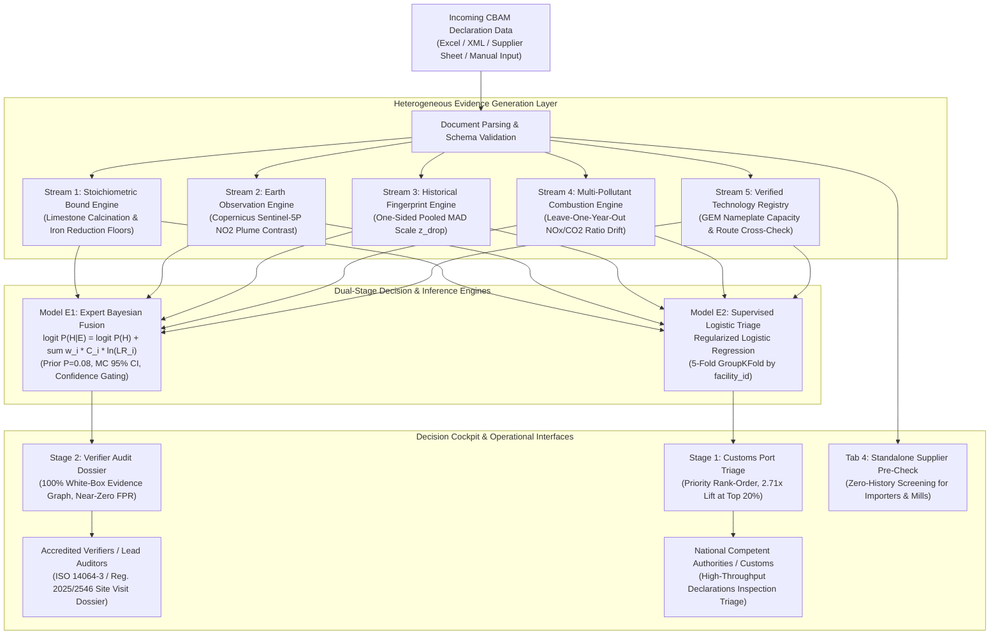

# Capstone Project Proposal: VeriCBAM
## Multimodal Evidence Fusion & Decision Support for CBAM Emissions Consistency Assessment

**Student Name:** Cristhian David Cáceres Mateus  
**Student ID / Matriculation No:** 93515346  
**Degree Program:** Master of Science in Data Science (M.Sc. DSc)  
**Academic Institution:** University of Europe for Applied Sciences (UE Germany), Berlin Campus  
**Faculty Supervisor:** Dr. Humera Noor  
**Submission Date:** October 2026 (Semester Winter 2026/2027)  
**Official Code Repository:** [https://github.com/CaceresCristhian/VeriCBAM](https://github.com/CaceresCristhian/VeriCBAM)  
**Associated Registration Form:** [`admin/VeriCBAM_Capstone_Application_Form_Filled_v2.pdf`](file:///admin/VeriCBAM_Capstone_Application_Form_Filled_v2.pdf)  

---

## 1. Project Overview & Problem Statement

### 1.1 The Regulatory & Economic Context
On **1 January 2026, the European Union's Carbon Border Adjustment Mechanism (CBAM) entered its definitive financial enforcement phase** under **Regulation (EU) 2023/956**. Following a two-year transitional reporting phase (October 2023 – December 2025 governed by **Commission Implementing Regulation (EU) 2023/1773**), European industrial importers—designated as *Authorised CBAM Declarants*—importing carbon-intensive commodities (**Cement, Iron & Steel, Aluminium, Fertilisers, Electricity, and Hydrogen**) face strict legal liability. They are required by law to surrender CBAM certificates annually corresponding to the verified embedded direct (Scope 1) and indirect (Scope 2) greenhouse gas emissions ($t\text{CO}_2e$) of their imported goods. These certificates are priced at the weekly average EU Emissions Trading System (EU ETS) auction price of allowances (Directive 2003/87/EC), typically trading between **€65 and €90+ per metric tonne of $\text{CO}_2$**.

While the **Omnibus I Simplification Regulation (EU) 2025/2083** introduced a cumulative 50-tonne annual mass *de minimis* exemption threshold for small importers, approximately **99% of embedded industrial emissions** remain subject to mandatory third-party verification and financial certificate surrender.

### 1.2 The Industrial Screening Dilemma & Verification Bottleneck
European industrial buyers, customs declarants, and National Competent Authorities (such as Germany's *Deutsche Emissionshandelsstelle - DEHSt*, France's *DGEC*, the Netherlands' *NEa*, and Poland's *KOBiZE*) face an acute operational and economic bottleneck:

1. **The Escalating Financial Cost of Physical Audits:**  
   Under Regulation (EU) 2023/956 (Articles 8 & 9), **Commission Implementing Regulation (EU) 2025/2546** (verification principles), **Commission Delegated Regulation (EU) 2025/2551** (verifier accreditation), and **Commission Implementing Regulation (EU) 2025/2547** (calculation of embedded emissions), physical on-site installation visits represent the regulatory default when claiming actual embedded emissions. Third-party verification costs scale steeply with industrial complexity:
   * **Simple Units:** €5,000 to €15,000 per facility (e.g., standalone scrap electric arc furnace or downstream rolling mill).
   * **Medium Heavy Industrial Sites:** €15,000 to €50,000 per facility (e.g., standalone cement clinker rotary kiln).
   * **Complex Integrated Heavy Industry (The VeriCBAM Target Focus):** **€50,000 to €150,000+ per site visit** (industry estimates; GMK Center, 2024; EC SWD(2021) 643 final) for integrated Blast Furnace–Basic Oxygen Furnace (BF-BOF) steelworks and multi-kiln cement mega-complexes. When factoring in international auditor deployment to third countries (e.g., India, China, Turkey, Brazil, Ukraine), forensic chemical assay of raw meal/coke, and local logistics, comprehensive compliance burdens impose substantial friction on international supply chains.

2. **The "Arithmetic of Scarcity" & Administrative Timeline Delays:**  
   A severe structural market failure compounds this cost burden:
   * **Demand vs. Supply Deficit:** An estimated **~12,000 EU import entities** are seeking authorized CBAM declarant status across tens of thousands of supplying installations worldwide. Yet historically, only **~403 verification bodies** held EU ETS accreditation under the Accreditation and Verification Regulation (**AVR - Commission Implementing Regulation (EU) 2018/2067**) across Europe; dedicated CBAM verifier accreditations under **Commission Delegated Regulation (EU) 2025/2551** roll out gradually from late 2026.
   * **Extended Verification Lead Times:** A complete physical site verification cycle takes **3 to 6 months** from initial engagement, monitoring plan reconciliation, on-site physical walk-through, to final report sign-off.
   * **The Punitive Alternative (Default Value Mark-Up):** If an overseas installation cannot secure verified data in time, importers are forced to surrender CBAM certificates calculated via the European Commission's **default emissions values**, which carry punitive administrative mark-ups under Implementing Regulation (EU) 2025/2547:
     $$\text{Markup} = +10\% \text{ (2026)} \longrightarrow +20\% \text{ (2027)} \longrightarrow +30\% \text{ (from 2028)}.$$
     For an integrated steel mill exporting 500,000 tonnes of steel, this default surcharge imposes an unrecoverable **€5,000,000 to €20,000,000+** penalty.

3. **Three Critical Evasion & Technical Inconsistency Vectors:**  
   * **Vector A — Selective Quantitative Understatement:** Deliberately under-reporting fuel consumption or raw material calcination by 10%–50% to evade certificate surrender liability while maintaining normal physical manufacturing output.
   * **Vector B — Stoichiometric Floor & Boundary Manipulation:** Declaring specific embedded emissions below the physical chemical conservation-of-mass limits required to reduce iron ore or calcine limestone, or exporting high-calorific blast furnace process gases across legal fence lines to adjacent power plants without allocating them to product emissions.
   * **Vector C — Process Route Misclassification ("Greenwashing"):** Claiming that high-carbon primary steel (produced via integrated BF-BOF, $\approx 1.85\text{ t CO}_2/\text{t}$) was manufactured via a low-carbon secondary route (Scrap-EAF, $\approx 0.08\text{ t CO}_2/\text{t}$ direct Scope 1).

### 1.3 The VeriCBAM Objective & Scope Boundaries
**VeriCBAM** is an **explainable, multimodal industrial intelligence and decision-support system** designed to screen and assess the consistency of self-reported CBAM declarations. 

Rather than claiming to replace accredited legal certification bodies or directly measure facility CO₂ emissions from space, VeriCBAM functions as an **evidence-fusion auditor copilot**:
* It establishes **physical plausibility** via first-principles chemical engineering process bounds and Best Available Techniques (BAT) benchmarks.
* It evaluates **operational activity consistency** via Copernicus Sentinel-5P TROPOMI tropospheric $\text{NO}_2$ atmospheric plume contrast.
* It compares behavior against **facility historical fingerprints and multi-pollutant co-emission ratios** ($\text{NO}_x/\text{CO}_2$ and $\text{SO}_x/\text{CO}_2$) from verified industrial registries.
* It integrates these heterogeneous data streams through a **weighted Bayesian evidence-fusion engine (Model E1)** and a **facility-grouped supervised triage model (Model E2)** that quantify risk alongside explicit confidence and uncertainty intervals.
* It delivers an **explainable reasoning graph and audit dossier** for human decision-makers, including a **standalone pre-screening tool** for importers and overseas suppliers.

> **Methodological Scope & Regulatory Proxy Qualification:**  
> Because official third-country CBAM declarations are legally confidential during the transitional phase, VeriCBAM's empirical benchmark utilizes authentic European facility-level Scope 1 emissions from the European Environment Agency (EEA E-PRTR / IED v16 database) as an **independent regulatory proxy** rather than product-level CBAM embedded intensities (EU Implementing Regulation 2025/2547). The system is positioned strictly as a verification and triage decision-support tool, preserving human auditor authority under EU administrative law.

---

## 2. Research Questions & Hypotheses

### 2.1 Central Research Question
> **To what extent can heterogeneous physical, observational, historical, and multi-pollutant evidence be fused into an explainable decision-support model that identifies controlled CBAM emissions inconsistencies more reliably than isolated single-modality sources?**

### 2.2 Formal Research Sub-Questions & Hypotheses
* **RQ1 (Physical Plausibility & Stoichiometric Floors):**  
  *Question:* How accurately can first-principles chemical engineering mass balances (limestone calcination and iron reduction) establish conservative lower bounds on declared emissions without relying on historical facility data?  
  *Hypothesis $H_1$:* Stoichiometric mass-balance floors can deterministically detect gross understatements ($\ge 30\%$) and route misclassifications with high precision (>98% on applicable facilities, with an observed 1.55% false-alarm rate on authentic plant-years), but will remain blind to moderate understatements ($10\%–20\%$) that remain above the physical floor.
* **RQ2 (Earth Observation Activity & Atmospheric Limits):**  
  *Question:* Can Copernicus Sentinel-5P TROPOMI tropospheric $\text{NO}_2$ column density serve as a quantitative operational activity proxy for heavy industry, and what are its physical limitations?  
  *Hypothesis $H_2$:* Due to coarse spatial footprint ($5.5 \times 3.5\text{ km}$), regional background advection, wind dispersion, and persistent cloud obscuration, satellite trace-gas observations alone cannot reliably quantify annual plant-level $\text{CO}_2$ emissions (yielding near-random discriminative power when uncoupled from ground activity), but provide valuable qualitative operational gating when clear-sky conditions exist.
* **RQ3 (Historical Behavior & Multi-Pollutant Fingerprinting):**  
  *Question:* Can facility-specific multivariate historical profiles and co-pollutant combustion ratios ($\text{NO}_x/\text{CO}_2$) detect selective $\text{CO}_2$ under-reporting in newly declared reporting periods?  
  *Hypothesis $H_3$:* High-temperature combustion couples $\text{NO}_x$ and $\text{CO}_2$ formation; under the controlled benchmark condition where declared $\text{CO}_2$ is selectively understated while permit-regulated $\text{NO}_x$ remains unperturbed, this causes a statistically detectable divergence in the leave-one-year-out co-pollutant ratio, independent of remote sensing.
* **RQ4 (Multimodal Evidence Fusion vs. Single Modalities):**  
  *Question:* Does fusing physical, observational, historical, and co-pollutant evidence streams yield superior discrimination, probability calibration, and false-positive control compared to isolated modalities?  
  *Hypothesis $H_4$:* While historical trajectory alone achieves high raw statistical discrimination, combining it with stoichiometric boundaries and confidence gating in a weighted Bayesian framework (Model E1) provides an ultra-low false-positive rate on authentic compliant plants ($\le 1\%$ at $\tau = 0.5$) and full legal explainability, while supervised logistic fusion (Model E2) optimizes probability calibration ($\text{ECE} \approx 0.063$).
* **RQ5 (Uncertainty Quantification & Missing Data Handling):**  
  *Question:* How can an evidence-fusion engine systematically represent observational uncertainty (e.g., cloud cover, unobserved capacity, missing historical years) without generating overconfident false alarms?  
  *Hypothesis $H_5$:* A formal evidence confidence factor $C_i \in [0, 1]$ combined with an explicit `Insufficient Evidence` abstention gate ($C_{\text{overall}} < 0.50$) provides an architectural safeguard against premature adverse audit findings when evidence is noisy or missing (noting that in the primary benchmark cohort with complete registries, the abstention rate remained at 0.0%).
* **RQ6 (Explainability & Dual-Stage Regulatory Triage):**  
  *Question:* Can an automated system generate auditable, evidence-grounded dossiers that satisfy the strategic and risk analysis requirements of Commission Implementing Regulation (EU) 2025/2546?  
  *Hypothesis $H_6$:* A dual-stage architecture—deploying supervised classification (Model E2) for high-throughput customs port triage and white-box Bayesian log-odds reasoning (Model E1) for accredited verifier audit dossiers—supports the strategic and risk analysis principles of Commission Implementing Regulation (EU) 2025/2546 while maintaining auditable evidential trails.

---

## 3. System Architecture & Mathematical Formulations



### 3.1 Chemical Engineering Stoichiometry (Conservation of Mass)
Physical mass-balance floors represent deterministic boundaries rooted in chemical stoichiometry and European Commission Best Available Techniques (BAT):

#### A. Cement Clinker Calcination & BAT Thermal Floor
Thermal decomposition of calcium carbonate ($\text{CaCO}_3$, molar mass $100.0869\text{ g/mol}$) into quicklime ($\text{CaO}$, $56.0774\text{ g/mol}$) and carbon dioxide ($\text{CO}_2$, $44.0095\text{ g/mol}$):
$$\text{CaCO}_3 \xrightarrow{\Delta H = +178\text{ kJ/mol}} \text{CaO} + \text{CO}_2 \uparrow$$
$$\gamma_{\text{CaO}} = \frac{M_{\text{CO}_2}}{M_{\text{CaO}}} = \frac{44.0095}{56.0774} = 0.78480\text{ t CO}_2/\text{t CaO}$$

Standard Portland cement clinker requires a minimum mass fraction $f_{\text{CaO}} \ge 0.63$ (central $0.65$), yielding an inescapable chemical calcination floor:
$$EF_{\text{calc, min}} = 0.63 \times 0.78480 \approx 0.495\text{ t CO}_2/\text{t clinker} \quad (\text{Central: } 0.525\text{ t CO}_2/\text{t clinker})$$

Adding the Best Available Techniques (EU CLM BREF 2013) minimum thermal fuel combustion for a state-of-the-art 5-stage preheater/precalciner dry kiln ($2.9\text{--}3.3\text{ GJ/t clinker}$) establishes:
$$EF_{\text{thermal, min}} = 0.275\text{ t CO}_2/\text{t clinker}$$
$$E_{\text{floor, clinker}} = P_{\text{clinker}} \times (0.495 + 0.275) - E_{\text{CCUS, verified}} = 0.770\text{ t CO}_2/\text{t clinker} - E_{\text{CCUS}}$$

#### B. Primary & Secondary Steelmaking Route Floors
* **Integrated Blast Furnace – Basic Oxygen Furnace (BF-BOF):**  
  Carbothermic reduction of hematite ore ($\text{Fe}_2\text{O}_3 + 3\text{C} \rightarrow 2\text{Fe} + 3\text{CO} \rightarrow 3\text{CO}_2$) establishes a reduction minimum of $1.182\text{ t CO}_2/\text{t hot metal}$. Including blast furnace thermal enthalpy balance ($300\text{--}360\text{ kg coke/t}$), sintering/coking, and up to $15\%–20\%$ scrap dilution in the BOF converter:
  $$EF_{\text{floor, BF-BOF}} = 1.350\text{ t CO}_2/\text{t crude steel} \quad (\text{European industrial benchmark: } 1.75\text{--}1.95\text{ t/t})$$
* **Direct Reduced Iron – Electric Arc Furnace (DRI-EAF, Natural Gas Shaft):**  
  $$EF_{\text{floor, DRI-EAF}} = 0.550\text{ t CO}_2/\text{t crude steel (Direct Scope 1)}$$
* **Secondary Scrap – Electric Arc Furnace (Scrap-EAF):**  
  Melting 100% recycled ferrous scrap (emissions from graphite electrode wear and burners only):
  $$EF_{\text{floor, Scrap-EAF}} = 0.040\text{ t CO}_2/\text{t crude steel (Direct Scope 1)}$$

#### C. Conservative Utilization Proxy & Transferred Process Gas Boundary Rule
When auditing against external registry capacity (rather than audited production), VeriCBAM evaluates the conservative floor at **minimum plausible utilization ($\eta_{\min} = 0.50$)**:
$$E_{\text{floor, conservative}} = C_{\text{nameplate}} \times 0.50 \times EF_{\text{floor, route}}$$

#### D. The Real-World Industrial Boundary Problem (Why Textbook Chemistry Fails Without System Modeling)
In academic literature, mass-balance stoichiometry is often treated as a trivial textbook exercise. In industrial practice, however, heavy industrial facilities are not isolated closed systems:
* **Off-Gas Transfers Across Fence Lines:** In modern integrated blast furnace steelworks, carbothermic reduction produces enormous volumes of high-energy Blast Furnace Gas (BFG) and Coke Oven Gas (COG). In major industrial clusters, these process gases are routinely piped across legal property lines to external utility power stations or adjacent district heating networks. Consequently, the direct Scope 1 stack emissions of the steelmaking installation appear deceptively low, because a substantial portion of the chemical carbon leaves the legal perimeter in gaseous form to generate off-site electricity.
* **The Naive Model Failure:** If an audit system naively evaluates the steel plant using standard textbook stoichiometry alone, it inevitably triggers false alarms on compliant facilities. VeriCBAM resolves this by incorporating cross-registry system boundary mapping: for facilities with documented off-gas export infrastructure (e.g., *ArcelorMittal Bremen, Eisenhüttenstadt, Taranto, HKM Duisburg, Tata Steel IJmuiden*), the stoichiometric stream sets `stoich_applicable = False` and explicitly abstains ($\hat{p} = \text{NaN}$) until complete site energy balances are provided, eliminating false accusations against compliant producers.

#### E. The Structural Blind Spot of Physical Basements
Stoichiometric process bounds establish a deterministic lower basement (e.g., $1.350\text{ t CO}_2/\text{t}$ for BF-BOF steel; $0.770\text{ t CO}_2/\text{t}$ for cement clinker). However, physical floors have an inherent structural blind spot:
* If an integrated blast furnace normally operates at $1.90\text{ t CO}_2/\text{t}$, and the operator under-reports its emissions as $1.55\text{ t CO}_2/\text{t}$, **stoichiometry alone is completely blind to this evasion**, because $1.55 > 1.35$.
* Physical boundaries are mathematically incapable of detecting moderate understatements that remain above the theoretical minimum. To close this gap, an audit system must fuse physical limits with longitudinal statistical baselines and multi-pollutant combustion profiles.

### 3.2 Multi-Pollutant Combustion Ratio ($\text{NO}_x/\text{CO}_2$)
Within-facility high-temperature combustion couples fuel/thermal $\text{NO}_x$ and $\text{CO}_2$ emissions (median empirical $\text{CV} = 11.1\%$ across European plants). For facility $i$ in year $t$, VeriCBAM calculates the leave-one-year-out ratio $R_{i, -t} = \text{Median}_{s \neq t}(E_{\text{NO}_x, i, s} / E_{\text{CO}_2, i, s})$ and robust scale $\sigma_{R, i, -t}$. A sharp increase in the observed ratio indicates that declared $\text{CO}_2$ dropped without an operational reduction in combustion activity.

#### A. The Multi-Pollutant Regulatory Invariant Dilemma
The inclusion of co-pollutant ratios addresses the risk of data falsification through a structural regulatory invariant:
* Heavy industrial installations are already subject to continuous environmental monitoring for toxic local air pollutants ($\text{NO}_x$, $\text{SO}_2$, particulate matter) under municipal and national operating permits (such as the EU Industrial Emissions Directive, national air quality laws, or automated continuous emission monitoring systems - CEMS).
* While an operator faces a strong financial incentive to depress declared $\text{CO}_2$ under trade carbon mechanisms, they face immediate legal penalties and operational shutdowns if they tamper with locally mandated air pollution permits.
* If an operator selectively under-reports $\text{CO}_2$ to customs authorities while their local environmental permits reflect normal high-temperature combustion $\text{NO}_x$, the co-pollutant ratio diverges sharply. Reconciling false carbon declarations against separate, independently enforced air quality registries creates an effective deterrence mechanism.

### 3.3 Longitudinal Historical Trajectory (One-Sided Pooled MAD Scale)
For facility $i$ in year $t$, longitudinal log-ratio drift is evaluated against the historical median $M_{i, -t} = \text{Median}_{s \neq t}(\ln E_{\text{CO}_2, i, s})$ and scaled by the cohort-wide pooled Median Absolute Deviation ($\sigma_{\text{pooled}} = 0.0911$ across 177 plant-years):
$$z_{\text{drop}, i, t} = \max\left(0, -\frac{\ln E_{\text{declared}, i, t} - M_{i, -t}}{\sigma_{\text{pooled}}}\right)$$
The one-sided operator $\max(0, -z)$ ensures that production expansions ($E_{\text{declared}} > M_{i, -t}$) receive $z_{\text{drop}} = 0$ and are never penalized.

### 3.4 Earth Observation Activity (Copernicus Sentinel-5P TROPOMI)
Tropospheric $\text{NO}_2$ column density ($\text{mol/m}^2$, Level-2 product filtered at `qa_value >= 0.50`) is extracted within a 5 km facility radius ($\bar{V}_{\text{target}}$) and compared to a 15–30 km background ring ($\bar{V}_{\text{bg}}$):
$$z_{\text{sat}} = \frac{\bar{V}_{\text{target}} - \bar{V}_{\text{bg}}}{1.4826 \times \text{MAD}_{\text{bg}}}, \qquad C_{\text{sat}} = \max(0, 1 - f_{\text{cloud}})$$

#### A. Physical & Atmospheric Realities of Spaceborne Observations
A common misconception in carbon accounting is that spaceborne remote sensing can directly meter annual factory emissions. VeriCBAM incorporates satellite data with explicit physical and atmospheric qualifications:
* **Spatial Footprint:** Sentinel-5P TROPOMI pixels ($5.5 \times 3.5\text{ km}$) encompass entire industrial parks, nearby transport arteries, and surrounding residential heating, diluting point-source signals.
* **Atmospheric Dispersion & Lifetime:** Tropospheric $\text{NO}_2$ is a short-lived photochemical tracer heavily influenced by planetary boundary layer height, wind advection, and hydroxyl radical chemistry, introducing significant meteorological variance.
* **Persistent Cloud Obscuration:** In temperate industrial regions, cloud decks obscure optical spectrometers for substantial portions of the year, providing sporadic clear-sky overpass snapshots rather than continuous monitoring.
* **The True Role of Satellite Data:** Spaceborne observation functions effectively as an **auxiliary operational activity gate**—verifying whether a facility was physically active, cycling, or completely idle—rather than an annual emissions meter.

### 3.5 Weighted Bayesian Evidence Fusion (Model E1)
$$\operatorname{logit} P(H \mid E) = \operatorname{logit} P(H) + \sum_{k=1}^{6} w_k \cdot C_k \cdot \ln(\operatorname{LR}_k)$$
- **Baseline Prior:** $P(H) = 0.08$ ($\operatorname{logit} P(H) = -2.4423$).
- **Evidential Weights:** Route Match ($w=2.00$), Stoichiometric Floor ($w=1.50$), Multi-Pollutant Ratio ($w=1.20$), Historical Drop ($w=1.00$), Satellite Plume ($w=1.00$), Registry Capacity ($w=0.80$).
- **Monte Carlo Uncertainty & Abstention Gating:** 500 log-likelihood perturbation draws generate 95% credible intervals. If overall weighted confidence $C_{\text{overall}} < 0.50$, the system outputs `Insufficient Evidence`.

### 3.6 Supervised Triage Classifier (Model E2)
An $L_2$-regularized Logistic Regression model trained on standardized multimodal feature vectors via **5-Fold `GroupKFold(groups=facility_id)`**, ensuring zero facility or spatial data leakage between folds.

---

## 4. Empirical Datasets: Reference Observations & Graded Benchmark

### 4.1 Layer A: Real-World Reference Cohort (EEA E-PRTR / IED v16)
* **Dataset Provenance:** Official European Pollutant Release and Transfer Register (E-PRTR) & Industrial Emissions Directive (IED) integrated database v16.0 (DOI: `10.2909/657ac3cb-affa-4295-a4a9-27b4f539adab`).
* **Cohort Structure:** Exactly 30 premier European industrial installations (15 Cement, 15 Steel) spanning 9 EU Member States (Germany, Poland, Austria, France, Netherlands, Italy, Slovakia, Greece, Sweden, Denmark).
* **Observation Completeness:** Exactly **177 authentic facility-year observations** across 2018–2023. Three facility-years are missing due to documented blast furnace relinings (e.g., ArcelorMittal Bremen BF2 in 2020) and are left unimputed.
* **Biomass Data Sparsity Finding (Step 11):** In the official EEA dataset, `co2_excl_biomass_tonnes` is missing (`NaN`) for **144 of 177 facility-years (81.4% missingness)**, with only 33 non-null records. Total direct `Carbon dioxide (CO2)` is therefore the only complete, verified pan-European regulatory series.

### 4.2 Verified Technology & Capacity Registry
Constructed from the Global Energy Monitor (GEM) Global Steel & Cement Trackers, corporate sustainability reports, and official national environmental operating permits (e.g., Bezirksregierung Düsseldorf, Arpa Puglia, GIOŚ Poland), documenting:
* Exact process route, clinker/crude steel nameplate capacities, and kiln configurations.
* Verified historical operating utilization bounds ($\eta \in [0.50, 0.95]$).
* Transferred process gas flags identifying installations exporting blast furnace gas across legal boundaries.

### 4.3 Layer B: Primary 325-Case Graded Evaluation Benchmark
To rigorously evaluate model performance in the absence of public non-EU fraud datasets, VeriCBAM introduces a curated **325-case graded evaluation suite**:
1. **177 Authentic Real-Year Negatives:** Unperturbed historical facility-years ($y \in [2018, 2023]$) capturing natural operating variance ($\sigma_{\text{pooled}} = 0.0911$).
2. **140 Graded Understatements:** Synthetic understatements generated across 5 distinct perturbation magnitudes:
   $$\delta \in \{5\%, 10\%, 20\%, 30\%, 50\%\}, \quad (28\text{ cases per magnitude})$$
   testing detection from subtle deviations ($\delta = 5\%$) to severe fraud ($\delta = 50\%$).
3. **8 Route Misclassifications:** Cross-route anomalies (e.g., claiming Scrap-EAF emissions for integrated BF-BOF works; Hamborn excluded due to zero crude steel capacity).

---

## 5. Experimental Results, Ablations & Key Scientific Insights

### 5.1 Primary Graded Benchmark Performance (325 Cases across 30 Facilities, 36.92% Positive Prevalence, Primary Rule $\delta \ge 10\%$)
Evaluated across 1,000 facility-clustered bootstrap resamples (95% confidence intervals):

| Model Architecture | Statistical Paradigm | ROC-AUC (95% CI) | PR-AUC (95% CI) | Brier Score | ECE | Authentic FPR | Recall @ 5% FPR | Recall @ 10% FPR | Abstention Rate | Recommended Role |
| :--- | :--- | :---: | :---: | :---: | :---: | :---: | :---: | :---: | :---: | :--- |
| **Model A: Naive Prior** | Constant Baseline ($P=0.08$) | 0.5000 [0.500, 0.500] | 0.3692 [0.369, 0.369] | 0.2329 | 0.3192 | 0.00% | 0.00% | 0.00% | 0.0% | Null Baseline |
| **Model B: Stoichiometry Alone** | First-Principles Chemical Bound | 0.7909 [0.719, 0.891] | 0.7326 [0.641, 0.845] | 0.1884 | 0.1571 | 1.55% | 33.73% | 48.33% | 28.6% | Hard Physical Veto |
| **Model C: Satellite Alone (S-5P)\*** | Tropospheric $\text{NO}_2$ Plume | 0.5183 [0.499, 0.544] | 0.3781 [0.359, 0.396] | 0.3731 | 0.3474 | 96.61%\* | 6.67% | 11.67% | 0.0% | Auxiliary Qualitative Check |
| **Model D: Historical Alone** | Robust Longitudinal Drop $\max(0, -z)$ | 0.9631 [0.957, 0.972] | 0.9428 [0.931, 0.957] | 0.0826 | **0.0632** | 6.78% | 83.33% | 90.83% | 0.0% | Historical Anomaly Detection |
| **Model E1: Expert Bayesian Fusion** | Log-Odds + Confidence Gating | 0.8935 [0.865, 0.924] | 0.8684 [0.832, 0.901] | 0.1530 | 0.1652 | **0.56%** | 69.17% | 70.00% | 0.0% | **Stage 2: Verifier Audit Dossier** |
| **Model E2: Learned Logistic** | Supervised GroupKFold Fusion | **0.9643** [0.956, 0.973] | **0.9484** [0.938, 0.961] | **0.0787** | **0.0630** | 6.78% | **85.00%** | **91.67%** | 0.0% | **Stage 1: Customs Port Triage** |

*\*Note on Model C: The 96.61% Authentic FPR for Model C is an artifact of applying a standard $\tau = 0.5$ cutoff to an uncalibrated raw proxy score. At matched false-alarm rates (10% FPR), its recall is 11.67%, consistent with random observational noise in cloudy temperate zones.*

### 5.2 Key Methodological & Empirical Insights
1. **The Step 6 Methodological Finding (Matched FPR Parity):**  
   When evaluated at matched false-alarm rates ($\text{FPR} = 5\%, 10\%$), **Model D (Historical Alone: Recall@5% = 83.33%, Recall@10% = 90.83%)** performs nearly identically to **Model E2 (Learned Logistic: Recall@5% = 85.00%, Recall@10% = 91.67%)**. This establishes that longitudinal historical drift is the dominant statistical driver of recall in facility reporting within this benchmark. The distinct value of multimodal Bayesian fusion (**Model E1**) lies in **physical interpretability, boundary-aware constraint enforcement, and an ultra-low authentic false positive rate (0.56% at $\tau = 0.5$)**, protecting compliant plants from unwarranted physical audits.
2. **Satellite Remote Sensing Limitation (Empirical Negative Result):**  
   Tropospheric $\text{NO}_2$ plume contrast shows no significant correlation with annual $\text{CO}_2$ ($\rho = 0.198, p = 0.312$ cross-sectionally; within-plant mean $\rho = -0.100$). Satellite alone achieves $\text{ROC-AUC} = 0.5183$. This empirical exploratory pilot (covering 5 plants across cloudy European conditions) demonstrates that satellite observations alone are inconclusive for annual facility-level verification, justifying downweighting satellite evidence as an auxiliary operational gate ($w_{\text{sat}} = 1.0$).
3. **Step-by-Step Methodological Attribution:**  
   Dynamically tracking pipeline ablation configurations: Baseline (Phase 0: E1 AUC 0.8404) $\rightarrow$ Removal of Unverified Capacity Fallback (E1 AUC 0.8432) $\rightarrow$ Leave-One-Out $\text{NO}_x$ (E1 AUC 0.8382, reflecting natural variance in multi-pollutant ratios) $\rightarrow$ Combined One-Sided Sign Score & Process Gas Boundary Filter (Primary E1 AUC **0.8935**, Auth FPR **0.56%** at $\tau = 0.5$).

### 5.3 Auditor Resource-Constraint Triage Simulation
Simulating customs inspection capacity against a random baseline ($36.92\%$ positive prevalence in the 325-case benchmark suite):
* **Top 10% Budget (32 cases):** Model E1 achieves **100.0% Precision (2.71x lift)**; Model E2 achieves **100.0% Precision (2.71x lift)**.
* **Top 20% Budget (65 cases):** Model E1 achieves **98.5% Precision (2.67x lift)**; Model E2 achieves **100.0% Precision (2.71x lift)**, capturing **54.2% of all benchmark understatements**.
* **Top 30% Budget (97 cases):** Model E2 achieves **92.8% Precision (2.51x lift)**, capturing **75.0% of all synthetic understatements in this benchmark cohort**.

---

## 6. Project Work Plan, Gantt Chart & Risk Management

```mermaid
gantt
    title VeriCBAM Capstone Project Execution Roadmap (Winter 2026/2027)
    dateFormat  YYYY-MM-DD
    section Academic Milestones
    Milestone 1: Topic Approval       :milestone, m1, 2026-10-12, 0d
    Milestone 2: Proposal Approval    :milestone, m2, 2026-10-26, 0d
    Progress Report 1 (Sprint 1)      :milestone, m3, 2026-11-09, 0d
    Progress Report 2 (Sprint 2)      :milestone, m4, 2026-11-23, 0d
    Progress Report 3 (Sprint 3)      :milestone, m5, 2026-12-07, 0d
    Progress Report 4 (Sprint 4)      :milestone, m6, 2026-12-21, 0d
    Final Thesis Submission           :milestone, m7, 2027-01-04, 0d
    Thesis Defense & Oral Exam        :milestone, m8, 2027-01-18, 0d

    section Sprints & Implementation
    Sprint 0: Cohort Ingestion & Clean:done, s0, 2026-10-03, 2026-10-14
    Sprint 1: Stoichiometry & XML/XLSX:active, s1, 2026-10-15, 2026-11-09
    Sprint 2: Multi-Year S-5P & Ratios:s2, 2026-11-10, 2026-11-23
    Sprint 3: Full Bayesian & Calibration:s3, 2026-11-24, 2026-12-07
    Sprint 4: UI Cockpit & Dossier PDF:s4, 2026-12-08, 2026-12-21
    Sprint 5: Thesis Drafting & Defense:s5, 2026-12-22, 2027-01-18
```

### 6.1 Technical Risk Management Matrix
| Identified Risk | Severity | Likelihood | Impact on Project | Proactive Mitigation Strategy |
| :--- | :---: | :---: | :--- | :--- |
| **Persistent Cloud Obscuration in S-5P** | High | High | Overpass data gaps over North/Central Europe. | Formal clear-sky QA filter (`qa_value >= 0.50`), dynamic confidence gating ($C_{\text{sat}} = 1 - f_{\text{cloud}}$), and explicit `Insufficient Evidence` abstention gate. |
| **Transferred Process Gases in Steelworks** | High | High | False physical violation flags on BF-BOF plants exporting gas to off-site power plants. | Verified GEM/permit boundary mapping setting `stoich_applicable = False` for transferred-gas plants; conservative floor evaluated at 50% capacity. |
| **Biomass Emission Reporting Missingness** | Medium | High | Inability to separate biogenic fuel CO₂. | Documented that 81.4% (144/177) of EEA records lack excluding-biomass CO₂; standardized on total direct $\text{CO}_2$ as verified regulatory proxy. |
| **Data Leakage in Supervised Models** | Critical | Low | Artificially inflated benchmark metrics. | Implemented 5-fold `GroupKFold` cross-validation grouped strictly by `facility_id`, completely isolating facilities between folds. |

### 6.2 Future Research Roadmap: Multi-Sensor Operational Activity Proxying (VeriCBAM 2.0)
While the current implementation uses Sentinel-5P tropospheric $\text{NO}_2$ as an operational presence check, our empirical analysis highlights the necessity of multi-sensor remote sensing to independently reconstruct factory activity. A planned second-stage roadmap includes:
1. **Thermal Infrared (TIR) Operating Timelines:**  
   Industrial rotary cement kilns operate at internal temperatures exceeding $1,400^\circ\text{C}$, radiating external shell heat at $200^\circ\text{C}\text{--}350^\circ\text{C}$, while primary steel tapholes pour molten iron at $1,500^\circ\text{C}$. Leveraging satellite thermal infrared sensors (such as Landsat-8/9 TIRS or high-resolution commercial thermal platforms) enables detecting continuous thermal anomalies, reconstructing an indisputable operational timeline of kiln firing versus maintenance shutdowns.
2. **All-Weather Synthetic Aperture Radar (SAR):**  
   Optical and thermal sensors remain constrained by cloud decks in temperate industrial zones. In contrast, Sentinel-1 C-band SAR penetrates persistent cloud cover, rain, and operates regardless of daylight. By tracking temporal changes in radar backscatter over heavy metal structures, scrap yards, and processing units, SAR establishes an all-weather activity index.
3. **Computer Vision for Freight & Logistics Tracking:**  
   Applying object detection to high-resolution optical imagery (Sentinel-2, PlanetScope) to monitor raw material stockpile depletion (limestone, coal, iron ore) and count bulk cargo barges and railcars at industrial terminals allows independent estimation of physical production volume ($Q$). This estimated volume can then be directly paired with stoichiometric intensity bounds.

---

## 7. Deliverables & Resource Management

### 7.1 Core Software & Academic Deliverables
1. **VeriCBAM Core Engine (`src/`):** Clean, modular Python package featuring stoichiometric calculators (`cement_models.py`, `steel_models.py`), leave-one-year-out ratio extractors (`nox_baseline.py`), and Bayesian log-odds fusion (`evidence_fusion.py`).
2. **Interactive 8-Tab Streamlit Decision Cockpit (`src/ui/app.py`):**
   * **Tab 1: Executive Overview & Architecture:** System KPIs, regulatory timeline, and 4-level evidence hierarchy.
   * **Tab 2: Facility Cohort & Geospatial Inspector:** Interactive map highlighting selected plants with historical $\text{CO}_2$ timelines and legal threshold overlays.
   * **Tab 3: Stoichiometric Feasibility & Route Sandbox:** Chemical mass-balance simulator testing calcination, iron reduction, and scrap dilution.
   * **Tab 4: Standalone Supplier Plausibility Pre-Check:** Zero-history pre-screening module for importers and non-EU suppliers.
   * **Tab 5: Copernicus Sentinel-5P Satellite Inspector:** Orbital $\text{NO}_2$ plume contrast and cloud-gating inspector.
   * **Tab 6: Bayesian Evidence Fusion & Audit Dossier:** Waterfall log-odds chart, prior sensitivity curve, and 1-click Markdown audit dossier export.
   * **Tab 7: Empirical Benchmark Evaluation & Ablation:** Live comparison of all 6 models across 325 graded scenarios with triage simulation.
   * **Tab 8: Capstone Proposal, References & Roadmap:** Master academic documentation and direct EUR-Lex ELI links.
3. **Automated Master Reproduction Pipeline (`scripts/reproduce_all.py`):**
   Executes all 11 data generation, modeling, calibration, and testing stages end-to-end with 100% deterministic reproducibility.
4. **Automated Test Suite:** **28/28 passing unit and integration tests** in `tests/` (`pytest`).
5. **Open-Source GitHub Repository:** Hosted at [https://github.com/CaceresCristhian/VeriCBAM](https://github.com/CaceresCristhian/VeriCBAM).

---

## 8. Required Milestone Deliverables: LinkedIn Thought-Leadership Post

*(Required under Milestone 2 — October 26, 2026)*

### Conceptual Project Announcement (Idea-Only, Zero Numerical Data)
*A purely conceptual statement presenting the research project, the regulatory dilemma, and the evidence-fusion architecture without empirical numbers, statistics, or prematurely claimed results.*

```markdown
With the European Union's Carbon Border Adjustment Mechanism (CBAM) entering definitive financial enforcement, European importers of carbon-intensive commodities like steel and cement face legal responsibility for the emissions embedded in their global supply chains.

The compliance challenge is immediate: verifying supplier carbon declarations requires physical on-site audits, yet accredited verifiers are scarce worldwide and international site visits are logistically constrained. Meanwhile, self-reported carbon spreadsheets cannot always be taken at face value.

For my Master’s Capstone in Data Science at the University of Europe for Applied Sciences (Berlin), supervised by Dr. Humera Noor, I am working on Project VeriCBAM: an explainable decision-support framework designed to screen industrial emissions reports against independent evidence before physical audits are scheduled.

Instead of treating emissions estimation as a black-box machine learning problem, the framework approaches verification as an evidence-fusion challenge:
• Grounding declarations in first-principles chemical engineering (establishing mass-balance lower bounds for iron reduction and limestone calcination).
• Cross-referencing facility reporting history and co-pollutant combustion profiles from independent environmental registries.
• Leveraging spaceborne Earth observation as an external activity check to confirm whether industrial sites were operational.
• Unifying these heterogeneous signals into a transparent, white-box decision model that helps compliance officers prioritize where in-depth audits are truly needed.

The goal is not to replace accredited human verifiers, but to provide them with an objective, physics-informed screening copilot that highlights physical inconsistencies and directs attention where it matters most.

How is your organization approaching data integrity and verification in global carbon supply chains?

#DataScience #MachineLearning #PhysicsInformedAI #CBAM #IndustrialDecarbonization #SupplyChainCompliance #ExplainableAI #CleanTech
```

---

## 9. Academic & Regulatory Reference Bibliography

1. **European Union (2023):** *Regulation (EU) 2023/956 of the European Parliament and of the Council of 10 May 2023 establishing a carbon border adjustment mechanism.* Official Journal of the European Union, L 130/52. [ELI: http://data.europa.eu/eli/reg/2023/956/oj]
2. **European Commission (2025):** *Commission Implementing Regulation (EU) 2025/2546 of 10 December 2025 on the application of the principles for verification of declared embedded emissions pursuant to Regulation (EU) 2023/956.* [ELI: http://data.europa.eu/eli/reg_impl/2025/2546/oj]
3. **European Commission (2025):** *Commission Implementing Regulation (EU) 2025/2547 of 10 December 2025 laying down rules for the calculation, monitoring, and reporting of embedded emissions in goods imported into the customs territory of the Union.* [ELI: http://data.europa.eu/eli/reg_impl/2025/2547/oj]
4. **European Commission (2025):** *Commission Delegated Regulation (EU) 2025/2551 of 20 November 2025 (published in OJ L on 10 December 2025) supplementing Regulation (EU) 2023/956 with requirements for the accreditation, control, and oversight of verifiers.* [ELI: http://data.europa.eu/eli/reg_del/2025/2551/oj]
5. **European Parliament & Council (2025):** *Regulation (EU) 2025/2083 of the European Parliament and of the Council (Omnibus I Simplification Package).* [ELI: http://data.europa.eu/eli/reg/2025/2083/oj]
6. **European Commission (2023):** *Commission Implementing Regulation (EU) 2023/1773 of 17 August 2023 laying down rules for the transitional period of Regulation (EU) 2023/956.* [ELI: http://data.europa.eu/eli/reg_impl/2023/1773/oj]
7. **European Commission (2018):** *Commission Implementing Regulation (EU) 2018/2067 on the verification of data and on the accreditation of verifiers (Accreditation and Verification Regulation - AVR).* [ELI: http://data.europa.eu/eli/reg_impl/2018/2067/oj]
8. **European Parliament & Council (2010):** *Directive 2010/75/EU on industrial emissions (integrated pollution prevention and control) (Industrial Emissions Directive - IED).* [ELI: http://data.europa.eu/eli/dir/2010/75/oj]
9. **European Environment Agency (EEA) (2026):** *Industrial Reporting Database: Industrial Emissions Directive (IED) 2010/75/EU and European Pollutant Release and Transfer Register (E-PRTR) Regulation (EC) No 166/2006 (Version 16.0, February 2026).* Copenhagen. [DOI: 10.2909/657ac3cb-affa-4295-a4a9-27b4f539adab]
10. **European Commission Joint Research Centre (JRC) (2013):** *Best Available Techniques (BAT) Reference Document for the Production of Cement, Lime and Magnesium Oxide (CLM BREF).* Seville. [ELI: http://data.europa.eu/eli/dec_impl/2013/163/oj]
11. **European Commission Joint Research Centre (JRC) (2012):** *Best Available Techniques (BAT) Reference Document for Iron and Steel Production (IS BREF).* Seville. [ELI: http://data.europa.eu/eli/dec_impl/2012/135/oj]
12. **IPCC (2019):** *2019 Refinement to the 2006 IPCC Guidelines for National Greenhouse Gas Inventories, Volume 3: Industrial Processes and Product Use (IPPU).* Chapter 2 (Mineral Industry) and Chapter 4 (Metal Industry). IGES, Japan. [URL: https://www.ipcc-nggip.iges.or.jp/public/2019rf/vol3.html]
13. **European Commission (2021):** *Commission Staff Working Document: Impact Assessment Report Accompanying the document Proposal for a Regulation establishing a Carbon Border Adjustment Mechanism.* **SWD(2021) 643 final**, Brussels.
14. **Global Energy Monitor (GEM) (2024–2026):** *Global Steel Plant Tracker (GSPT)* and *Global Cement and Concrete Plant Tracker (GCCT).* [URL: https://globalenergymonitor.org]
15. **GMK Center (2024):** *CBAM Verification: Requirements, Costs and Industry Bottlenecks in the Steel Sector.* Industry economic assessment & consultancy report, Kyiv/Brussels. [URL: https://gmk.center]
16. **International Organization for Standardization (2019):** *ISO 14064-3:2019: Greenhouse gases — Part 3: Specification with guidance for the verification and validation of greenhouse gas statements.* Geneva.
